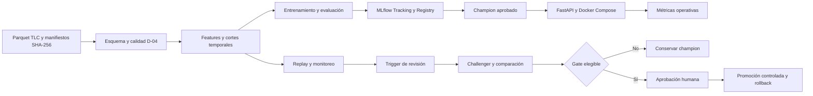

# NYC Yellow Taxi MLOps

**Predicción de duración de viajes y ciclo MLOps local, auditable y reversible.**

[](https://github.com/ModoJorgeBT/nyc-yellow-taxi-mlops/actions/workflows/ci.yml)
[](.python-version)
[](reports/final/completion.md)

Plataforma de maestría de **Universidad CENFOTEC** que estima la duración de un
viaje en minutos al abordar. Integra datos NYC Yellow Taxi, controles de calidad,
features temporales, entrenamiento, MLflow Registry, FastAPI, Docker Compose,
CI, monitoreo retrospectivo y un ciclo champion/challenger con aprobación humana.

[Arquitectura](docs/architecture.md) · [Runbook](docs/runbook.md) ·
[Resultados](#resultados-del-modelado) · [Demo](reports/final/demo-script.md) ·
[Presentación](reports/final/presentation.md) · [Historial de entregas](docs/commit-history.md)

## Estado del proyecto

| Área | Resultado verificado |
|---|---|
| Plataforma | T01–T38 desarrolladas; cierre técnico final y G6 documentados |
| Champion | **LightGBM v4**, aprobado y registrado; alias `champion` conservado |
| Challenger | LightGBM v5 entrenado con todo 2025; **rechazado por el gate** |
| Serving | FastAPI y Compose local; integridad del modelo, smoke y persistencia verificados |
| Observabilidad | Métricas operativas, calidad, PSI y desempeño con etiquetas maduras |
| Operación reversible | Promoción, rollback y compensación HTTP probados con modelos **sintéticos aislados** |
| Reproducción | Venv limpio, wheels exactos de caché, cero descargas externas; **681 pruebas aprobadas y una omisión prevista** |
| Revisión humana | Ejecución por otro integrante y defensa oral **NO VERIFICADAS** |

El cierre técnico distingue pruebas locales, CI remoto y evidencia histórica.
El último intento final conservó un timeout de arranque sintético y su repetición
trazada; no se ocultó el fallo ni se elevaron los límites.
[Evidencia y alcance exactos](reports/final/completion.md).

## Arquitectura



El despliegue es local. MLflow utiliza SQLite y artefactos persistentes; Compose
opera con una copia aislada del Registry nativo. El modelo se verifica por
versión, run y hashes antes de deserializarlo y se carga al iniciar la API.
Un cambio de alias no recarga automáticamente un servicio ya iniciado.

| Componente | Tecnología o contrato |
|---|---|
| Datos | Parquet / PyArrow; manifiestos, hash y registro idempotente |
| Features | Pipeline compartido de scikit-learn; ajustes solo con train |
| Modelos | Baseline de mediana exacta, SGDRegressor, MLPRegressor y LightGBM |
| Tracking | MLflow 3.16.1, Registry, SQLite y artefactos persistentes |
| Serving | FastAPI, validación estricta, respuestas y errores controlados |
| Ejecución | Python 3.14.7; Docker Compose Linux amd64 y límites por servicio |
| CI | GitHub Actions: fixtures, contrato API, imágenes y renderer aislado |
| Monitoreo | PSI, métricas exactas y Evidently en entorno separado |
| Operación | CLI manual, aprobaciones acotadas, diario y rollback por identidad |

## Datos y prevención de leakage

El inventario local comprende **30 meses**: 2024 y 2025 completos, más
enero–junio de 2026. Los 24 archivos aportados conservan procedencia
`LOCAL_UNVERIFIED`; los seis descargados de 2026 tienen URL y hash registrados.
La calidad se evalúa por bloques, sin cargar todos los meses en memoria.

- **Entrada del predictor:** zona de origen, hora/día/mes de recogida y pasajeros
  opcionales, bajo la hipótesis explícita de disponibilidad al abordar.
- **Variables posteriores excluidas:** destino, dropoff, distancia y cargos.
  El destino se utiliza únicamente para segmentar la evaluación posterior.
- **Tiempo:** timestamps históricos interpretados en `America/New_York`, duración
  entre instantes UTC y separación de horarios DST ambiguos o inexistentes.
- **Calidad:** D-04 conserva umbrales, FAIL y exclusiones. Las excepciones requieren
  aprobación humana ligada a mes/hash/reporte; no se extienden a otros archivos.
- **Evaluación:** ventanas temporales, transformaciones train-only, identidad de
  filas, reservas de evaluación y cobertura auditadas.

| Ciclo | Entrenamiento | Validación | Evaluación reservada | Replay |
|---|---|---|---|---|
| Inicial | 2024 | Ene–mar 2025 | Abr–jun 2025: baseline/SGD/MLP | Jul–dic 2025 |
| Extensión LightGBM v4 | 2024 | Ene–mar 2025 | Ene–mar 2026: nueva evaluación independiente en ese ciclo | Sin reajuste con replay |
| Challenger v5 | 2025 | Ene–mar 2026, declarado **conocido** | Abr–jun 2026: nueva comparación independiente | No se usa para seleccionar |

La extensión LightGBM preservó la selección SGD y el test de la primera
comparación. El carácter independiente de Q1 2026 corresponde a esa extensión;
en el ciclo siguiente se declara validación conocida.
[Preparación T14](reports/quality/t14_completion.md) ·
[Protocolo de retraining](docs/t32-t34-retraining.md).

## Resultados del modelado

**Evaluación independiente inicial: enero–marzo de 2026, 10.937.087 viajes.**
Modelos congelados, mismas filas y ningún reajuste con esta ventana.

| Modelo | MAE, minutos |
|---|---:|
| Baseline: mediana global exacta | 9,141254 |
| SGD Huber | 8,352735 |
| **LightGBM v4** | **7,742891** |

LightGBM v4 se entrenó con **41.119.495 viajes elegibles de 2024** y 100 árboles.
Su elección como champion fue humana, con limitaciones por rutas reconocidas;
no se realizó optimización de hiperparámetros.
[Evaluación completa](reports/evaluation/lightgbm_final_evaluation.md) ·
[Decisión del champion](reports/model_selection.md).

**Gate posterior: abril–junio de 2026, 11.603.243 viajes.**
V5 se entrenó desde cero con **48.144.298 viajes elegibles de 2025**.

| Modelo | MAE | RMSE | MedAE | P90 de error absoluto |
|---|---:|---:|---:|---:|
| Champion v4 | 8,096751 | 12,634822 | 5,314210 | 17,904528 |
| Challenger v5 | 8,037052 | 12,515600 | 5,279114 | 17,752281 |

Todas las métricas están en minutos. V5 mejora MAE **0,737317 %**, por debajo
del **2 % mínimo aprobado**: permanece registrado sin alias y **v4 conserva
champion**. Los demás controles y 27 segmentos cumplieron el protocolo.
No se comparan ventanas distintas como si fueran el mismo experimento.
[Entrenamiento v5](reports/retraining/t33_challenger.md) ·
[Gate y auditoría completa](reports/retraining/t34_comparison.md).

## Empezar en Windows

Requisitos: Git, PowerShell y Python **3.14.7 x64**. Docker Desktop con WSL2
en modo Linux se necesita para Compose. Clonar el repositorio aporta código,
configuración, documentación y fixtures sintéticas pequeñas; los datos reales,
pesos, SQLite y cachés permanecen locales.

### Desarrollo y pruebas sin datos reales

Los comandos de instalación requieren acceso a los paquetes del lock. No hace
falta activar el entorno ni cambiar la política de ejecución de PowerShell.

```powershell
git clone https://github.com/ModoJorgeBT/nyc-yellow-taxi-mlops.git
Set-Location nyc-yellow-taxi-mlops
py -3.14 --version
py -3.14 -m venv .venv
.\.venv\Scripts\python.exe -m pip --isolated install --require-hashes --only-binary=:all: -r requirements-dev.lock
.\.venv\Scripts\python.exe -m pip --isolated install --no-index --no-deps --no-build-isolation -e .
.\.venv\Scripts\python.exe -m ruff check .
.\.venv\Scripts\python.exe -m pytest -q --basetemp=.cache/readme-tests -o cache_dir=.cache/readme-pytest-cache
```

Ese entorno ejecuta las pruebas de sus dependencias disponibles. La verificación
de **681 PASS** corresponde al runtime completo `.venv-mlflow`, con MLflow,
serving y modelos; Evidently se prueba en otro entorno para conservar su
compatibilidad con pandas 2.3.3. Bootstrap completo, locks, presupuestos y
troubleshooting: [runbook](docs/runbook.md).

### Reproducción offline y demos aisladas

Con los wheels exactos ya disponibles en la caché local:

```powershell
py -3.14 -m scripts.reproduce_local --output-dir .cache/repro-nueva
```

Genera un export con manifiesto SHA-256 y venv limpio, sin descargas externas.
Si falta un wheel, se detiene. El destino debe ser nuevo. La prueba automatizada
del export no acredita la revisión de otra persona.

Con el entorno MLflow preparado, ejecutar un escenario a la vez:

```powershell
.\.venv-mlflow\Scripts\python.exe -m scripts.demo_workflow --output-dir .cache/demo-workflow-nueva
.\.venv-mlflow\Scripts\python.exe -m scripts.demo_lifecycle --output-dir .cache/demo-lifecycle-nueva --external-rollback
```

Las demos utilizan fixtures y servicios propios en puertos libres, conservan
evidencia y detienen sus procesos. Demuestran registro sin promoción automática,
rechazo, promoción sintética, rollback y compensación ante fallo HTTP. No cambian
el champion real ni atribuyen a LightGBM las mejoras de modelos constantes.

### API con Docker Compose

Requiere imagen, modelo aprobado y seed del Registry previamente preparados.
Para una máquina nueva, seguir primero [build y bootstrap Docker](docs/t23-t25-docker.md).

```powershell
docker compose config --quiet
docker compose up -d --no-build --wait --wait-timeout 180 mlflow api
Invoke-RestMethod http://127.0.0.1:8080/health
Invoke-RestMethod http://127.0.0.1:8080/model-info
```

| Servicio | Dirección local |
|---|---|
| API / OpenAPI | http://127.0.0.1:8080/docs |
| MLflow Docker | http://127.0.0.1:5001 |
| MLflow nativo | http://127.0.0.1:5000 |

Ejemplo de solicitud, con timestamp ISO 8601 y offset obligatorio:

```powershell
$payload = @{
    pickup_datetime = "2026-04-15T08:30:00-04:00"
    pickup_location_id = 161
    passenger_count = 1
} | ConvertTo-Json
Invoke-RestMethod -Method Post -Uri http://127.0.0.1:8080/predict -ContentType "application/json" -Body $payload
```

| Endpoint | Contrato |
|---|---|
| `GET /health` | Salud y modelo cargado; 503 si no está disponible |
| `GET /model-info` | Identidad y versión del modelo realmente cargado |
| `POST /predict` | Minutos, unidad, versión y timestamp UTC; entrada inválida: 422 |

Los servicios se enlazan a loopback. `docker compose stop` conserva el volumen;
no ejecutar `down -v` ni reinicializar el Registry sin backup y aprobación.

## Monitoreo y operación

El replay julio–diciembre de 2025 cubre **24.266.924 viajes**, con referencia
mensual de train 2024, PSI, calidad y métricas exactas tras madurar las etiquetas.
Es una evaluación retrospectiva: no afirma que el servicio estuviera operativo
ni que los archivos TLC fueran públicos en cada instante histórico.

Los triggers recomiendan revisión por dos meses consecutivos con MAE >115 %
de la referencia o PSI >0,20 en la misma feature. La calidad no aceptada bloquea;
ninguna alerta lanza entrenamiento ni promoción automáticamente. Las métricas
operativas actuales de la API se informan por separado.

La operación v2 exige aprobación, gate elegible, artefactos íntegros y estado
previo recuperable. Su diario y controlador verifican identidad de procesos;
el rollback restaura aprobación/alias y comprueba HTTP. No es una transacción
distribuida. [Monitoreo](docs/t29-t31-monitoring.md) ·
[Triggers](reports/retraining/t32_trigger.md) · [Operación](docs/runbook.md).

## Organización y documentación

```text
src/
  ingestion/     Manifiestos, descarga y registro local explícito
  validation/    Esquema, D-04 y publicación de lotes aceptados
  features/      Target UTC y transformaciones compartidas
  training/      Particiones, modelos y tracking/Registry
  evaluation/    Métricas exactas y comparaciones temporales
  api/           Contrato REST, carga verificada y métricas
  monitoring/    Calidad, PSI, replay y desempeño
  retraining/    Triggers, challenger, gate, promoción y rollback
configs/         Políticas y contratos versionados
tests/           Unitarias, integración, API y fixtures sintéticas
scripts/         Build, smoke, auditorías y reproducción
docs/            Arquitectura, ADR, decisiones y operación
reports/         Evidencias Markdown; salidas grandes locales
.github/         CI de código, fixtures e imágenes
```

| Documento | Propósito |
|---|---|
| [Intent](intent.md), [spec](spec.md), [plan](plan.md) | Objetivo, contratos, tareas y criterios de aceptación |
| [Arquitectura](docs/architecture.md), [decisiones](docs/decisions.md) | Diseño, acuerdos y riesgos |
| [Runbook](docs/runbook.md) | Bootstrap, recursos, operación, recuperación y limpieza |
| [Cierre final](reports/final/completion.md), [trazabilidad](reports/final/traceability.md) | Resultados verificables, hashes y límites |
| [Guion](reports/final/demo-script.md), [presentación](reports/final/presentation.md) | Demostración y material académico |
| [Historial de entregas](docs/commit-history.md) | Evolución de las cinco entregas, commits y evidencia |

## Alcance y limitaciones

- Proyecto académico local: no acredita alta disponibilidad ni despliegue público.
- Datos/modelos y recibos de ejecución no se distribuyen por Git; un clon no
  contiene el champion listo para inferencia.
- Las excepciones D-04 y la procedencia desconocida de los archivos aportados
  permanecen visibles; aceptar un lote no elimina sus incumplimientos medidos.
- Las demos de promoción/rollback son **TEST_ONLY**. El challenger real v5 sigue
  rechazado y cualquier promoción futura requiere autorización específica.
- El timeout de arranque aislado, la revisión cruzada humana y la defensa oral
  conservan su estado explícito en el informe final.

Los reportes fechados y los PDF de avance son fotografías de sus entregas;
los pendientes históricos no sustituyen el estado resumido en este README.
