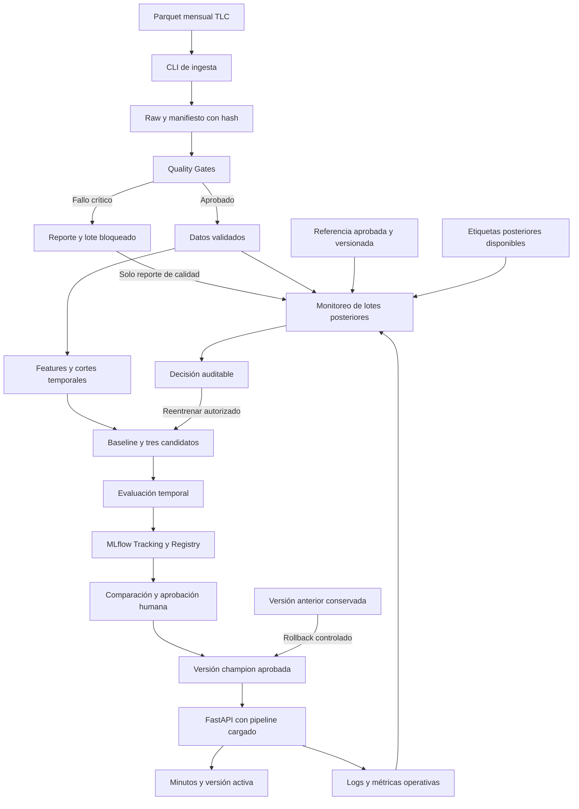

# T01 — Arquitectura lógica NYC Yellow Taxi MLOps

Fecha inicial: 2026-11-03; actualización: 2026-11-05. Arquitectura local; T14/T15, T16/T17 y evaluación final independiente auditadas. [Evaluación 2026](../reports/evaluation/lightgbm_final_evaluation.md); [T14](../reports/quality/t14_completion.md). [Tracking/Registry persistente T18](../reports/tracking/t18_completion.md) y [champion inicial LightGBM v4 T19](../reports/model_selection.md) implementados y auditados. G3 cumple su alcance; API, Docker y despliegue completo pendientes. Fuentes: [intent](../intent.md), [spec](../spec.md), [plan](../plan.md) y [PDF académico](../Proyecto_Maestria_MLOps_NYC_Taxi_Estructura.pdf).

## 1. Objetivo y límites

Estimar al inicio la duración de un viaje amarillo de NYC, en minutos, y demostrar un ciclo MLOps reproducible y auditable. T12/T13 aprobaron la etiqueta como diferencia UTC tras localizar los eventos históricos y apartar ambigüedad DST. Entradas v1: origen, calendario y pasajeros opcionales bajo disponibilidad al abordar; destino deshabilitado. No se usa distancia real de taxímetro, llegada, target ni importes finales como predictores.

Python, MLflow, FastAPI y Docker Compose en local son acuerdos del equipo; ver [ADR 0001](adr/0001-arquitectura-local.md). El resto del stack y sus versiones siguen el [registro de decisiones](decisions.md). No se introduce cloud, scheduler permanente ni infraestructura distribuida.

## 2. Flujo lógico propuesto

El diagrama expresa responsabilidades y dependencias futuras. No representa despliegue ni ejecución ya realizados. Evidently es la herramienta propuesta para reportes, pendiente en D-03. El destino se incorporará a features solo si se aprueba D-06.

Los lotes rechazados solo aportan sus reportes a la observación de calidad; su contenido no continúa al entrenamiento ni se considera aprobado para desempeño. La referencia de drift debe quedar identificada; su selección y ventanas permanecen pendientes en D-05.

## 3. Responsabilidades y artefactos

| Capa | Responsabilidad | Artefactos previstos / límites |
|---|---|---|
| Ingesta | Año/mes, procedencia e idempotencia | Raw, manifiesto URL/hash/fecha/tamaño/esquema; sin sobrescritura silenciosa. |
| Validación | Reglas estructurales y por registro/lote | Reporte PASS/WARN/FAIL; fallo crítico no produce dataset aprobado. |
| Features | Target histórico y entradas causales | Whitelist y transformaciones compartidas con serving; agregados deshabilitados inicialmente. |
| Modelado | Baseline, candidatos y evaluación cronológica | Métricas y configuración; ajuste solo con train, selección con validación, test reservado. |
| MLflow | Tracking, registro y linaje | Run, dataset/configuración/código, pipeline serializado y versión; registrar no promueve. |
| Serving | Cargar versión aprobada y validar solicitudes | Predict, health, model-info; minutos, unidad, versión realmente cargada y timestamp. |
| Observabilidad | Calidad, drift, desempeño y operación | Reportes por ventana; desempeño solo con etiquetas vinculadas; referencia por aprobar. |
| Retraining | Triggers y comparación | Recomendación, challenger y auditoría; promoción explícita y rollback. |
| CI | Pruebas y build reproducibles | Fixtures pequeñas y evidencia; herramienta pendiente, sin descarga masiva ni promoción automática. |

## 4. Diseño local con Compose

Servicios propuestos: `mlflow`, `api` y `pipeline` bajo demanda. La autorización del enfoque local no aprueba todavía SQLite, detalle de volúmenes, imágenes, librerías ni alias. Son decisiones D-03/D-07 por resolver antes de implementación.

- MLflow: tracking y registro; metadatos SQLite y directorio de artefactos persistentes son propuesta, no comprobación de durabilidad.
- API: carga pipeline de una versión aprobada; no selecciona el último run. El ejemplo de spec propone puertos host 5000/8000 limitados a localhost.
- Pipeline: CLI de ingesta, calidad, entrenamiento y monitoreo, invocable bajo demanda; no aloja un scheduler permanente.

Separar datos, metadatos, artefactos de modelos y reportes. La URI de tracking host/contenedor debe diferenciarse según spec §8. Queda pendiente decidir servicio de artefactos frente a montajes compartidos; una URI HTTP de tracking por sí sola no prueba que ambos clientes puedan cargar los modelos (R-09).

Antes de T24 deben fijarse permisos, persistencia, backup coherente, concurrencia y arranque. Las pruebas de persistencia de T18 requieren resolver su entorno local antes del Compose completo de T24 (H-07).

## 5. Bootstrap y operación

Secuencia prevista: aprobar herramientas/recursos/contratos → levantar tracking → ingesta y calidad → features y entrenamiento → evaluar y registrar candidatos → aprobar champion → cargar API → smoke tests. Los cortes y periodos deben aprobarse antes de datos masivos o entrenamiento real.

Compose no crea un champion. Spec permite arrancar API después del bootstrap o exponer estado no listo `503`; la opción operacional definitiva sigue pendiente. Se debe verificar readiness de dependencias, no solo orden de arranque. También falta decidir el comportamiento de una API ya cargada ante caída de MLflow.

El cambio de alias no demuestra que el servicio esté usando esa versión. La respuesta y model-info deben identificar el pipeline efectivamente cargado; una recarga fallida debe tener un procedimiento explícito de recuperación. Promoción/rollback conservan versión anterior, artefactos y auditoría; no se autoriza ninguna promoción en T01.

## 6. Fronteras temporales y de información

La fecha de recogida ordena los ejemplos, pero deben fijarse también disponibilidad de etiquetas y de lotes. El replay de datos históricos no se presenta como entrenamiento en tiempo real si esos datos aún no estaban publicados. Viajes que cruzan el corte, timestamps históricos y DST requieren política explícita antes de T13/T14.

Preprocesadores, baseline y estadísticas se ajustan solo con train. Las features derivadas de etiquetas, si se aprueban, usan únicamente viajes completados y disponibles antes de predecir, sin la propia etiqueta. El test final no se reutiliza para calibrar filtros, hiperparámetros ni promociones sucesivas. D-01/D-05 deben fijar nuevas ventanas evaluables para reentrenamiento.

Sin etiquetas, no hay MAE observado; el monitoreo informa indisponibilidad. La unión predicción/resultado requiere ID o protocolo de simulación explícito antes de T30. Drift es una señal de cambio de distribución y no acredita por sí mismo caída de desempeño.

## 7. Dependencias y validación futura

T01 solo documenta. T02 prepara estructura, T03 verifica entorno reproducible y T04 depende también de T03 para generar fixtures. T05 podrá perfilar una muestra autorizada de los Parquet que el equipo ya posee, sin repetir su descarga; colocarlos en raw no acredita validación ni linaje. Si falta procedencia, se registra como desconocida hasta resolver el protocolo de incorporación a manifiestos.

T12 necesita D-06 antes de aprobar features de destino. T14 debe probar disponibilidad de etiquetas al corte y declarar replay frente a disponibilidad real de publicación. Después, registro y aprobación habilitan serving; etiquetas y reportes habilitan decisiones de retraining. T34 depende de T25 para su smoke test. D-07 mantiene pendiente el entorno local de T18; no se implementa ahora.

La viabilidad del sistema completo sigue NO VERIFICADA: se deben medir RAM/CPU/disco host y Docker, dimensionar codificación/modelos y probar montajes/permisos. En T03 se aprobó Python 3.14.7 con herramientas de entorno y PyArrow fijados, sin instalar aún el stack de MLflow/serving/modelado. Esa prueba local de empaquetado no certifica Docker ni compatibilidad futura de todas las dependencias.

Evidencias futuras: fixture con lote inválido, prueba causal/temporal y DST, consistencia de pipeline serializado, reinicio con persistencia, respuestas 200/422/503, versión activa tras recarga, reportes con/sin etiquetas y rollback. T01 no ejecuta ninguna de estas pruebas.

## 8. Estado de revisión

La trazabilidad por página y los riesgos R-01…R-14 están en [decisions.md](decisions.md). La ingesta conserva separadas legibilidad Parquet, procedencia y aprobación de calidad; ver [contrato de ingesta](t06-t07-ingestion.md). Se autorizaron T08/T09: esquema raw aprobado y motor probado con fixtures, manteniendo configuración real PENDIENTE; ver [contrato de calidad](t08-t09-validation.md). Después se autorizaron T10/T11: CLI, linaje/exhaustividad y publicación de fixtures aisladas, sin aprobación para entrenamiento; ver [pipeline de datos](t10-t11-data-pipeline.md). Esas fases no aprobaron por si mismas las features ni la semántica temporal, resueltas posteriormente para v1 en T12/T13.

Actualización T12/T13: whitelist y convención temporal aprobadas tras consultar el diccionario, Pipeline compartido serializable y contexto de etiqueta separado de X. [Contrato y evidencia](t12-t13-features.md). La entrega inicial fue TEST_ONLY; después se aprobó D-04, se ejecutó el piloto de enero y se autorizaron los 24 hashes actuales. La preparación posterior T14/T15 registró 15 meses y completó calidad/features REAL de 14; marzo de 2025 fue rechazado. [Estado vigente y decisión de mantener D-04](t14-t15-quality-blocker.md). Calidad y permiso de uso son controles independientes. Contrato REST, controles de candidatos T16 e infraestructura siguen pendientes; G2 conserva revisión humana. Las referencias a decisiones pendientes en fases anteriores describen su estado histórico.

Actualización T14/T15: [particionado por bloques](t14-temporal-splits.md) y [baseline exacto en disco](t15-baseline.md), con catálogo explícito, cortes causales y supervisión. Software verificado con 333 pruebas en desarrollo y wheel. Perfil específico aprobado de preparación/baseline: 4 GiB libres/2 GiB RSS/50 GiB disco; T16 conserva 12/8. La preparación real se detuvo por calidad de marzo de 2025: no hay particiones ni baseline reales y no se ejecutó T16. Se conservan originales y versiones completas; ningún rechazo se convierte automáticamente en WARN ni en excepción.

Actualización posterior T15 independiente: separación de ajuste/evaluación aprobada. Ajuste exacto train 2024 completo y auditado: 41.119.495 etiquetas, mediana 12,983333 minutos; 561 filas apartadas por corte de etiqueta entre 41.120.056 elegibles DQ. Evaluación y cierre de T14/T15 pendientes de marzo 2025; D-04 permanece congelada. [Evidencia](../reports/quality/t15_train_fit.md). El flujo completo conserva las dependencias de T14; el nuevo CLI no publica sus marcadores ni evade calidad. No se añade infraestructura ni dependencias.

Actualización posterior: T15 completó ajuste y evaluación con el lector temporal compartido y datasets aprobados train/validation. Excepción humana solo para marzo/hash/reporte; calidad medida FAIL conservada. [Contrato](t15-march-exception.md), [resultado](../reports/quality/t15_baseline_validation.md). No se exige preparar test/replay para esta evaluación ni se declara T14 integral completa. Sin cambios de infraestructura/dependencias o promoción.

## Actualización de modelado — 2026-11-05

SGD Huber y MLP16 se ajustaron con las 41.119.495 filas train, una pasada por candidato. SGD fue elegido con validation antes de abrir test: MAE 6,876910 frente a 7,741890 del baseline. En test obtuvo MAE 7,965068 frente a 9,032999. MLP fue peor que el baseline; SGD empeoró ligeramente P90 en validation. Sin reajustes después de test ni promoción.

[Resultados](../reports/evaluation/t17_model_comparison.md). LightGBM se incorpora como extensión aprobada con representación compacta y categoría nativa de origen, sin nuevas variables; su evaluación será solo con validation. Los artefactos originales no cambian. [Protocolo](t16-lightgbm-extension-proposal.md). No hay champion ni servicios desplegados.

LightGBM 4.7.0 fue entrenado con las 41.119.495 filas train y 100 árboles. En las 11.163.264 filas validation: MAE 6.496404, RMSE 9.847425, MedAE 4.631360 y P90 13.478764 minutos. Ajuste y evaluación auditados; 447 pruebas por entorno. Solo validation: una nueva evaluación final independiente sigue pendiente. La selección SGD y el test de la primera comparación permanecen intactos; no hay promoción. [Evidencia](../reports/evaluation/lightgbm_validation.md). Entrenamiento nativo en proceso propio supervisado; conversión compacta de seis features y origen categórico train-only. Se conservan las entradas causales comunes; no se aplica el OHE/scaler de SGD/MLP a LightGBM.

**Evaluación final independiente completada y auditada — 2026-11-05:**
enero–marzo de 2026, 10.937.087 viajes; MAE LightGBM **7,742891 min**, SGD
**8,352735** y baseline **9,141254**. Se excluyeron 139.305 filas DQ mediante
tres excepciones humanas exactas y 814 por corte de etiqueta; los 27 raw,
modelos y selección de 2025 permanecen intactos. Reinicio de recursos aprobado
6 GiB libres/2 GiB RSS solo para inferencia final; entrenamiento 8/4 y preparación
4/2 sin cambios. 474 pruebas por entorno y auditoría completa. Sin promoción.
[Reporte final y trazabilidad](../reports/evaluation/lightgbm_final_evaluation.md). Las referencias anteriores a evaluación
final pendiente describen la entrega histórica previa a esta aprobación. T18
requiere D-07 y dependencias; no hay Registry ni champion todavía.

**T18 verificada — 2026-11-05:** D-07 aprobada e implementada con MLflow 3.16.1
en entorno separado, SQLite y artefactos persistentes. Cuatro candidatos:
baseline v1, SGD v2, MLP v3 y LightGBM v4, sin alias. Reinicio real, carga,
idempotencia y auditoría independiente PASS; 488 pruebas nativas más una omisión
explícita y 489 sobre wheel MLflow. Los modelos y evaluaciones anteriores no
cambian. Champion/T19 y G3 permanecen pendientes de aprobación.
[Registro y evidencia](../reports/tracking/t18_completion.md). Las referencias previas a D-07 o Registry
pendientes describen la cronología anterior a esta aprobación y ejecución.

**T19 verificada — 2026-11-05:** el usuario aprobó LightGBM v4 como champion
inicial, después de conocer las limitaciones por rutas, y descartó optimización
de hiperparámetros. Alias `champion` aplicado a la versión fija 4, run
`be28c76c84c44efa8914c5950a2959bf`; paquete, aprobación y resolución auditados.
501 pruebas nativas PASS y dos omisiones explícitas; 503 PASS sobre wheel MLflow.
G3 cumple sus condiciones de Sprint 3. D-05 conserva pendientes sus reglas
automáticas de drift y promociones futuras; no se aprueban nuevos umbrales.
[Decisión, pruebas y evidencia](../reports/model_selection.md). Las menciones anteriores a champion
pendiente son históricas; API y despliegue siguen en sus tareas posteriores.

**Serving T20–T22 — 2026-11-09:** contrato D-06 y HTTPX aprobados explícitamente.
Esquemas, carga segura del champion LightGBM v4 y endpoints FastAPI verificados;
553 casos serving, 501 nativos y 51 sobre wheel fuera de src. El reinicio
sintético de T18 necesitó reintento fuera del sandbox; pasó y se limpió su proceso.
Registry, modelos, evaluaciones y locks históricos intactos. Sin recarga
automática; Docker/T23–T25 y G4 pendientes. [Contrato y evidencia](t20-t22-serving.md).
Las menciones previas a API/contrato REST pendientes describen su estado histórico.

**T23–T25 verificadas — 2026-11-09:** build Docker Linux amd64, usuario
10001 y límites 2 GiB/2 CPU por API/MLflow verificados; smoke real 200/422/503,
reinicio y persistencia PASS. G4 cumple técnicamente su alcance. API en 8080
y MLflow Docker en 5001, solo loopback; originales conservados. El usuario
aprobó el perfil Linux, el cambio de puerto y la auditoría portable de
metadatos sin modificar datos. Volumen Linux aislado con champion v4;
sin reentrenamiento ni promoción nueva. [Guía y evidencia](t23-t25-docker.md).
Las menciones previas a Docker pendiente describen estados históricos;
T26–T38 y la revisión humana de resultados permanecen independientes.

**T26–T28 verificadas — 2026-11-09:** Actions prueba fixtures, API e imágenes
con backend fijado y presupuesto CI separado; PR verde y demostración
roja/verde reales, sin merge. El middleware ASGI emite ventanas agregadas
de 60 segundos a logs JSON, con memoria acotada y exportación local, sin
endpoint adicional. El monitoreo de calidad es offline sobre reportes
congelados: referencia train 2024 y comparación del mismo mes del replay
julio–diciembre 2025. Preserva FAIL, exclusiones y excepciones. No incorpora
Evidently, drift de distribuciones, reentrenamiento ni promociones automáticas.
[Contratos](t26-t28.md) y [evidencia GitHub](../reports/monitoring/t26_github_ci.md).
