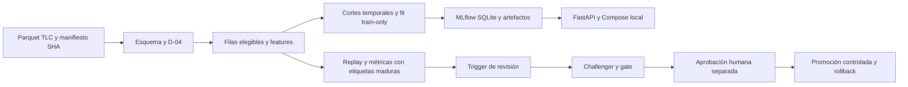

# NYC Yellow Taxi MLOps — material de presentación

## 1. Objetivo

Estimar minutos al abordar y demostrar un ciclo local auditable, reproducible
y reversible. Datos grandes y modelos quedan locales; Git contiene código,
políticas, fixtures y evidencia Markdown.

## 2. Arquitectura

MLflow nativo 5000; copia Docker 5001 y API 8080, todos loopback. La operación
T35 se demostró en otros puertos y namespace sintético; no cambió Docker.

## 3. Prevención de leakage

Origen, calendario NY y pasajeros opcionales disponibles bajo hipótesis al
abordar. Destino, distancia, tarifa/cargos y dropoff excluidos del predictor.
Target entre instantes UTC; DST ambiguo/inexistente apartado. Vocabulario y
transformaciones ajustados solo en train. Destino se usa después para segmentos.

## 4. Resultados reales y periodos

| Comparación | Filas | MAE en minutos | Interpretación |
|---|---:|---|---|
| Final independiente Q1 2026 | 10.937.087 | Baseline 9,141254; SGD 8,352735; LightGBM v4 7,742891 | Sustenta la elección inicial v4; luego este periodo es validación conocida |
| Gate independiente Q2 2026 | 11.603.243 | v4 8,096751; v5 8,037052 | Mejora 0,737317 %, insuficiente frente a 2 % |

Cada fila compara modelos sobre los mismos viajes de su ventana; las ventanas
tienen distribuciones diferentes. No comparar sus MAE como si fueran el mismo
experimento. V5: train completo 2025, 48.144.298 filas; v4: train 2024.
Sin tuning ni reajustes con final. V4 sigue champion; v5 se conserva sin alias.

## 5. Calidad, recursos e incidentes

D-04 conserva FAIL y excepciones humanas exactas, excluyendo inválidos. Fuentes
2024/2025 LOCAL_UNVERIFIED: no se inventa fecha de descarga. Primer fit T33
excedió RSS; se preservó y corrigió escritura por bloques, mismos datos/parámetros
y límite. Incidente previo de descargas Evidently también permanece documentado.
No confundir aceptaciones excepcionales con calidad sin incumplimientos.

## 6. Observabilidad y decisión

Replay julio–diciembre 2025: 24.266.924 filas, PSI y desempeño exacto. Dos meses
con PSI >0,20 de una feature o MAE >115 % de referencia recomiendan revisión.
No entrenan ni promueven automáticamente. Disponibilidad histórica del servicio
no observada; resultados son retrospectivos, no monitoreo online de 2025.

## 7. Operación demostrada

TEST_ONLY: gate negativo bloqueado; promoción 1→2; rollback 2→1 en otro
proceso; caída HTTP recuperada; control de conflicto y lock en tests. MLflow y
FastAPI reales con modelos constantes sintéticos. Las constantes no representan
un candidato científico. Journals conservan bytes/hashes y no borran versiones.

## 8. Reproducibilidad y alcance de cierre

Export aislado con manifiesto, venv limpio, wheels fijados de caché y cero
descargas externas; pruebas y logs según [cierre](completion.md). Publicación
Git de T32–T38 no realizada en este alcance. Revisión cruzada humana y defensa
oral **NO VERIFICADAS**. [Guion](demo-script.md), [trazabilidad](traceability.md).
